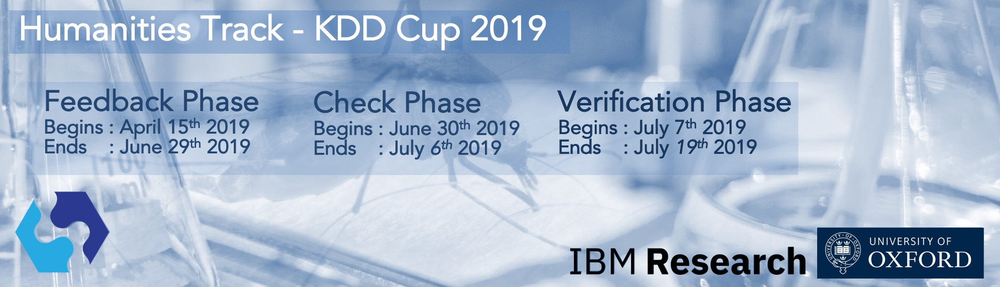
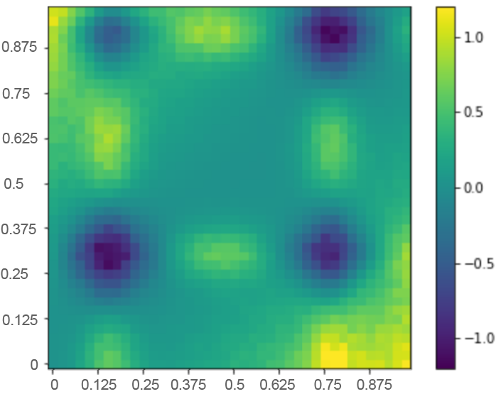
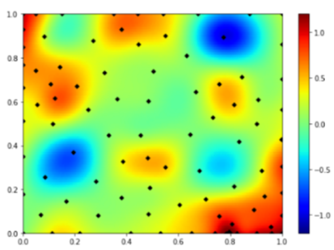
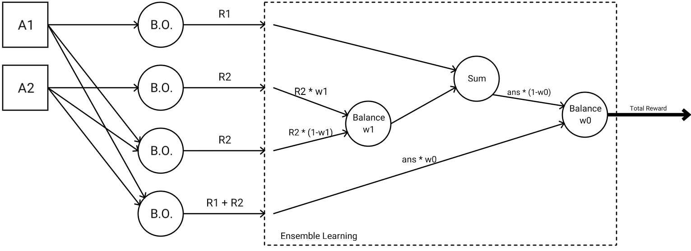

<h1 align="center">Policy Learning for Malaria Control 🦟</h1>

<p align="center">
  <b>Our team's solution to the KDD Cup 2019 Reinforcement Learning Challenge — ranked 7th worldwide.</b>
</p>

<p align="center">
  <a href="https://arxiv.org/abs/1910.08926"></a>
  
  <a href="LICENSE"></a>
</p>

We ("LOLs" team) were selected to represent the University of Passau in the KDD Cup 2019 RL Competition — *Policy Learning for Malaria Control* — where the goal is to learn a 5-year intervention policy that maximises health reward under a limited simulation budget. Our solution ranked **7th** and our work was later published as a [paper](https://arxiv.org/abs/1910.08926 "Arxiv pdf").

### ✨ Highlights
- 🎯 **Sample-efficient** — Bayesian Optimisation (Upper Confidence Bound) reaches strong policies from as few as ~89 simulated evaluations.
- 🧩 **Three complementary approaches** — sequential BO, full 10-D BO, and an ensemble that boosts them together.
- 📄 **Peer-reviewed** — methodology published on arXiv.

This repo regroups the different ML solutions the team built for the challenge.

<p align="center">
  
</p>

These solutions are based on Bayesian Optimisation techniques (Upper Confidence Bound).

 <div>
           <div style="width:80%;Text-align:center;float:left;">
         
<figure style="width:25%;float:left;margin:0px;text-align:center;padding:0px;">
  
  <figcaption>Fig.1 - Reward distribution for Year 1 (1600 points used)</figcaption>
</figure>
  
</div>
           
<div style="Text-align:right;Width:20%;float:right">
           
<figure style="width:25%;float:left;margin:0px;text-align:center;padding:0px;">
  
  <figcaption>Fig.2 - Reward estimation using Bayesian Optimisation (89 points used)</figcaption>
</figure>

</div>


</div>
           


the 3 most important solutions are:

### BO.1: BO with breaking sequence
This model uses 5 independents Bayesian Optimisation Objects. It focuses on maximizing the reward in a sequential way, starting from year 1.
 
### BO.2: 10 dimensional BO
This model uses only one Bayesian Optimisation Object. It is able to understand complex patterns between years and is able to model relations between the current reward and previously taken actions.

### BO.3: boosting network
This model combines the 2 previous algorithms thanks to the Ensemble learning techniques. It offers a more stable result: the worst case is always better than BO.1 and BO.2

<p align="center">
  
</p>


## Literature
bibtex to our paper:
```
@article{nguyen2019policy,
  title={Policy learning for malaria control},
  author={Nguyen, Van Bach and Karim, Belaid Mohamed and Vu, Bao Long and Schl{\"o}tterer, J{\"o}rg and Granitzer, Michael},
  journal={arXiv preprint arXiv:1910.08926},
  year={2019}
}
```
